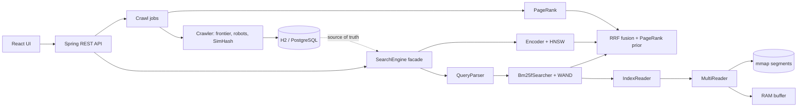

# Lookit

A search engine written from scratch in Java 21: crawler → analyzer → on-disk inverted index →
query parser → BM25F + WAND → dense vectors + HNSW → hybrid fusion → REST API → React UI.

The engine core (`analysis`, `index`, `search`, `vector`, `crawler`, `eval`) is plain Java with no
Spring, so it can be benchmarked and evaluated on its own; Spring Boot is a thin API and persistence
shell around it. Lucene is used **only** in tests, as a reference baseline.

## Results

Retrieval quality on [BEIR](https://github.com/beir-cellar/beir) benchmarks (nDCG@10, higher is better):

| System | SciFact (5k docs) | FiQA (57k docs) |
|---|---|---|
| TF-IDF | 0.584 | — |
| BM25, per-field sum | 0.668 | 0.249 |
| Lucene 9.12 BM25 (reference) | 0.683 | 0.254 |
| **BM25F** (tuned on train split) | **0.691** | 0.248 |
| Dense: all-MiniLM-L6-v2 + HNSW | 0.645 | **0.365** |
| **Hybrid: BM25F + dense, RRF** | **0.721** | 0.361 |

The best retriever depends on the corpus: lexical matching wins on SciFact's exact terminology,
dense retrieval wins on FiQA's informal questions (+0.12 over BM25F), and parameter-free fusion
helps only when both are competitive.

Performance on FiQA (57k docs, single thread, k = 10): WAND scores **22× fewer documents** than
exhaustive evaluation with an identical top 10; p50 latency 2.3 ms on memory-mapped segments;
859 QPS on 4 threads. HNSW finds 99 % of the exact top 10 at 39× the speed of brute force on FiQA. Details: [docs/evaluation.md](docs/evaluation.md) · [docs/performance.md](docs/performance.md).

## Features

| Layer | What is implemented |
|---|---|
| Analysis | Unicode tokenizer with offsets, Latin accent folding, CJK unigrams, 33 stopwords with position gaps, Porter stemmer (validated on the reference vocabulary) |
| Index | Fielded positional postings; immutable memory-mapped segments (delta + varint, 128-doc skip blocks); RAM buffer → flush; tombstone deletes; postings-level k-way merges; atomic manifest commits |
| Query | `AND` `OR` `NOT` `+` `-`, `"phrases"` (stopword-aware), `title:` / `body:`, `prefix*`, parentheses; never throws on malformed input |
| Ranking | BM25F, BM25, TF-IDF; doc-at-a-time scorers; top-k heap; **WAND** with stored per-term score bounds; PageRank prior |
| Semantic | all-MiniLM-L6-v2 on ONNX Runtime with a Java WordPiece tokenizer; **HNSW** index; **Reciprocal Rank Fusion** hybrid |
| Assistance | Spelling correction ("did you mean", Damerau–Levenshtein over a trigram index), autocomplete |
| Crawler | Polite per-host frontier, **RFC 9309 robots.txt**, Crawl-delay, robots meta / nofollow, **SimHash** near-duplicate detection, link graph + **PageRank**, async jobs |
| Evaluation | BEIR loader, nDCG@10 / MRR@10 / Recall@100, train-split tuning, Lucene baseline, latency/QPS/index-size benchmark |
| Service | REST API with validation and RFC 9457 errors, OpenAPI/Swagger UI, Prometheus metrics, H2 or PostgreSQL, Docker compose |

## Architecture



Design decisions and their reasons are recorded as ADRs in [docs/DECISIONS.md](docs/DECISIONS.md);
each milestone has a short write-up in [docs/phases/](docs/phases/).

## Quick start

Requirements: JDK 21, Maven 3.9, Node 22 (for the UI).

```sh
mvn -B test                       # 190+ tests
mvn spring-boot:run               # API on http://localhost:8080 (H2, index in data/index)
cd frontend && npm install && npm run dev   # UI on http://localhost:5173
```

Optional extras:

```sh
scripts/fetch-model.sh            # 90 MB embedding model → enables semantic & hybrid modes
scripts/fetch-beir.sh scifact     # 5,183 abstracts, loaded automatically on first start (and used for evaluation)
mvn -q compile exec:java -Dexec.args="data/beir/scifact"          # quality table
mvn -q compile exec:java -Dexec.mainClass=com.searchengine.eval.Benchmark -Dexec.args="data/beir/fiqa"
docker compose up --build         # PostgreSQL + API + UI on http://localhost:8081
```

On Windows use the `.ps1` variants in `scripts/`. The compose stack has been verified end to end:
all three containers start, keyword/semantic/hybrid search, suggestions, Swagger UI and Prometheus
work through the nginx proxy, and the index and embeddings survive an API restart.

## API

| Method | Path | Description |
|---|---|---|
| GET | `/api/search?q=&page=&size=&mode=keyword\|semantic\|hybrid` | Ranked results with snippets, highlight offsets, `didYouMean` |
| GET | `/api/suggest?q=` | Autocomplete for the last word |
| GET / POST / DELETE | `/api/documents[/{id}]` | Read, add, delete documents |
| POST | `/api/crawl` | Start a crawl job → `202 { jobId }` |
| GET / DELETE | `/api/crawl/{id}` | Job status (live counters) / cancel |
| GET | `/api/stats` | Corpus statistics |
| GET | `/swagger-ui.html`, `/actuator/prometheus` | API docs, metrics |

Query syntax examples: `"inverted index" -lucene`, `title:java +spring`, `retriev* AND (ranking OR scoring)`.

## Configuration

| Property (env var) | Default | |
|---|---|---|
| `lookit.index.dir` (`LOOKIT_INDEX_DIR`) | `data/index` | Persistent index directory; blank = in-memory |
| `lookit.vector.model-dir` (`LOOKIT_MODEL_DIR`) | `data/models/all-MiniLM-L6-v2` | Embedding model; missing = keyword only |
| `lookit.seed.beir-dir` (`LOOKIT_SEED_DIR`) | `data/beir/scifact` | Corpus loaded once into a fresh install (5,183 abstracts); missing = samples only |
| `lookit.crawler.min-delay-ms` | `1000` | Minimum delay between requests to one host |
| `lookit.ranking.pagerank-weight` | `0.3` | Weight of ln(PageRank) prior (ADR-012) |
| `spring.profiles.active=postgres` + `DB_URL`, `DB_USERNAME`, `DB_PASSWORD` | H2 | Use PostgreSQL |

## Project layout

```
src/main/java/com/searchengine/
  analysis/   Analyzer, Porter stemmer, stopwords
  index/      IndexReader, MemoryIndex, SegmentWriter/Reader, MultiReader, SegmentedIndex
  search/     Query AST + parser, BM25F, scorers, WAND, RRF, snippets, suggestions, SearchEngine
  vector/     WordPiece tokenizer, ONNX encoder, HNSW, vector store
  crawler/    Fetcher, robots.txt, SimHash, polite Crawler, PageRank
  eval/       BEIR loader, metrics, EvalRunner, Bm25fTuner, Benchmark
  api/ service/ document/   Spring layer
frontend/     React + Vite UI
docs/         ROADMAP, DECISIONS (ADRs), evaluation, performance, phase write-ups
```

## License

MIT — see [LICENSE](LICENSE).
