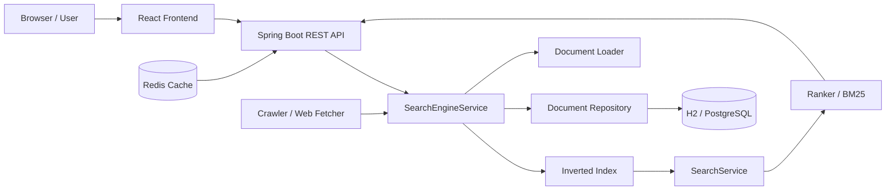

# Search Engine Project

Java-based search engine application built with Spring Boot and Maven.

## Current Stack

- Java: 25
- Spring Boot: 3.5.4
- Maven: 3.9.16
- Database: H2 by default, PostgreSQL profile available
- Cache: Redis support available

## Project Overview

This project provides a simple search engine API with:

- document indexing and search
- basic ranking and phrase search
- crawler support for fetching and indexing pages
- REST endpoints for search, document management, and crawling
- a local H2-backed default profile for easy startup

## Architecture / project flow



This keeps the project understandable: the frontend calls the API, the backend builds and queries an inverted index, documents are persisted in a database, and the crawler can add new content to the corpus.

## Git hygiene and environment safety

This repository intentionally avoids committed secrets.

- Keep local environment values in a `.env` file
- Do not commit real credentials or production passwords
- Use `.env.example` as a template only
- For Docker, prefer environment variables over hardcoded passwords

Example local `.env`:

```env
DB_URL=jdbc:postgresql://localhost:5432/searchengine
DB_DRIVER=org.postgresql.Driver
DB_USERNAME=searchengine
DB_PASSWORD=your_local_password
DB_DIALECT=org.hibernate.dialect.PostgreSQLDialect
REDIS_HOST=localhost
REDIS_PORT=6379
POSTGRES_DB=searchengine
POSTGRES_USER=searchengine
POSTGRES_PASSWORD=your_local_password
```

## How to Run

From the project root, use the project’s provided Maven setup:

```powershell
$env:JAVA_HOME = "C:\Users\max03\.jdks\jdk-25.0.2"
$env:Path = "$env:JAVA_HOME\bin;$env:Path"
.\tools\apache-maven-3.9.16\bin\mvn.cmd spring-boot:run
```

Or, if the environment is already configured:

```powershell
mvn spring-boot:run
```

## How to Run Tests

```powershell
$env:JAVA_HOME = "C:\Users\max03\.jdks\jdk-25.0.2"
$env:Path = "$env:JAVA_HOME\bin;$env:Path"
.\tools\apache-maven-3.9.16\bin\mvn.cmd clean test
```

The project is currently verified to pass under Java 25.

## Local Setup

This machine is configured with:

- JDK 25: `C:\Users\max03\.jdks\jdk-25.0.2`
- Maven 3.9.16: `tools/apache-maven-3.9.16`

Use these commands in PowerShell to verify the environment:

```powershell
java -version
javac -version
mvn -version
```

## Database Profiles

### Default local profile

The application starts with H2 by default, which is convenient for local development and testing.

### PostgreSQL profile

To run with PostgreSQL and Redis support:

```powershell
# start local services
powershell -ExecutionPolicy Bypass -File .\scripts\start-local-services.ps1

# run with PostgreSQL profile
mvn spring-boot:run -Dspring-boot.run.arguments="--spring.profiles.active=postgres"
```

Environment variables supported for the DB profile:

```text
DB_URL=jdbc:postgresql://localhost:5432/searchengine
DB_USERNAME=searchengine
DB_PASSWORD=your_local_password
DB_DRIVER=org.postgresql.Driver
CACHE_TYPE=simple
```

## Main API Endpoints

### Search

```http
GET /api/search?q=java search
```

### Get all documents

```http
GET /api/documents
```

### Get a single document

```http
GET /api/documents/1
```

### Create a document

```http
POST /api/documents
Content-Type: application/json

{
  "title": "New Java Article",
  "url": "local://new-java-article",
  "content": "Java article about search and ranking."
}
```

### Crawl a seed URL

```http
POST /api/crawl
Content-Type: application/json

{
  "seedUrl": "https://example.com",
  "maxPages": 2,
  "maxDepth": 1
}
```

## Notes

- The Maven build is now the canonical project workflow.
- Java 25 and Spring Boot 3.5.4 are the current verified runtime targets.
- The project is intended for local learning and iterative backend development, with optional PostgreSQL/Redis-backed profiles for more realistic usage.

## License

This project is licensed under the MIT License. See [LICENSE](LICENSE) for details.
